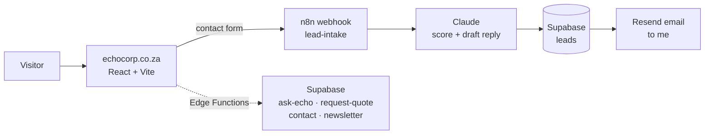

# echocorp.co.za

**The website for [Echo Corp](https://echocorp.co.za), my Johannesburg web and automation agency.** A fast, mobile-first React site whose contact form feeds a live AI lead-qualification pipeline.

🔗 **Live:** [echocorp.co.za](https://echocorp.co.za)


## What's interesting about it

- **Every enquiry is qualified by AI.** The contact form posts to an [n8n workflow](https://github.com/RiyasatR23/n8n-workflows) that has Claude score the lead (hot, warm or cold), saves it to Supabase and emails me a summary with a draft reply, usually within about 5 seconds.
- **Pre-rendered for SEO.** It's a React single-page app, but the build server-renders the homepage into `dist/index.html` (`scripts/prerender.mjs`), so Google sees real HTML instead of an empty `<div id="root">`. Inner pages ship as static HTML with their own meta tags, plus `sitemap.xml`, `robots.txt`, Open Graph tags and `ProfessionalService` structured data.
- **No secrets in the frontend.** Every API key (Anthropic, Resend, Supabase service role) lives in Supabase Edge Function environment variables. The browser only ever gets the public anon key.
- **Database locked down by default.** Supabase migrations turn on Row Level Security and only grant the service role access to enquiry and quote tables, so the public key can't read anyone's submissions.

## Screenshots

| Capabilities | Echo AI assistant |
|---|---|
|  |  |

| Pricing | Contact form → AI pipeline |
|---|---|
|  |  |

<p align="center"></p>

## Architecture



| Part | Tech |
|---|---|
| Frontend | React 18, TypeScript, Vite, Tailwind CSS, Lucide icons |
| SEO | Build-time pre-rendering, static inner pages, sitemap, Open Graph, JSON-LD |
| Lead pipeline | n8n (webhook → Claude → Supabase → Resend), see [n8n-workflows](https://github.com/RiyasatR23/n8n-workflows) |
| Backend functions | Supabase Edge Functions (Deno): `ask-echo` (Claude chat endpoint), `request-quote`, `contact-request`, `contact-message`, `newsletter-subscribe` |
| Database | Supabase Postgres with RLS, managed through SQL migrations in `supabase/migrations` |

The **Echo assistant** section on the homepage is a scripted sample conversation for a demo car audio shop. The live, Claude-powered version of the assistant is in [ask-echo](https://github.com/RiyasatR23/ask-echo) and runs on client sites.

## Project structure

```
src/
  components/      Hero, Capabilities, Services, Assistant, Pricing, Contact, ContactForm, …
  entry-server.tsx Server entry used for pre-rendering
  lib/             Supabase client, WhatsApp link helpers
scripts/
  prerender.mjs    Injects the server-rendered homepage into dist/index.html
public/            Static inner pages, logos, sitemap, robots.txt, OG image
supabase/
  functions/       Edge Functions (Deno + TypeScript)
  migrations/      Tables, RLS policies and grants
```

## Run it locally

```bash
npm install
cp .env.example .env    # add VITE_SUPABASE_URL and VITE_SUPABASE_ANON_KEY
npm run dev             # http://localhost:5173
npm run build           # production build + pre-render into dist/
```

## Built by

Riyasat Rehman, founder of Echo Corp · [LinkedIn](https://www.linkedin.com/in/riyasat-rehman-784724386) · [GitHub](https://github.com/RiyasatR23)

Built with [bolt.new](https://bolt.new), then hardened by hand for SEO, security and the automation pipeline.
